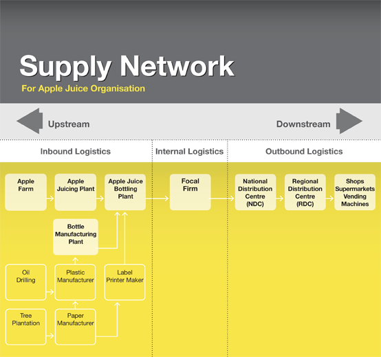
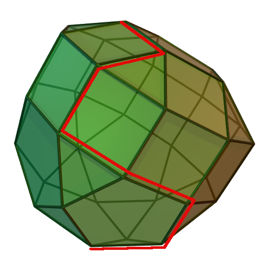
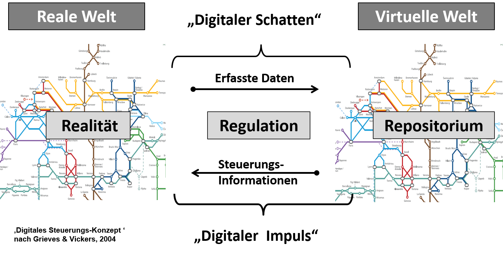
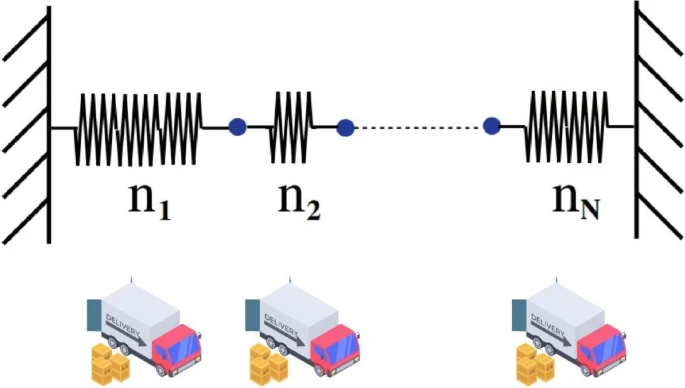
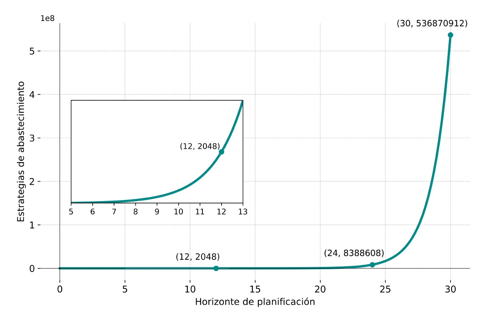
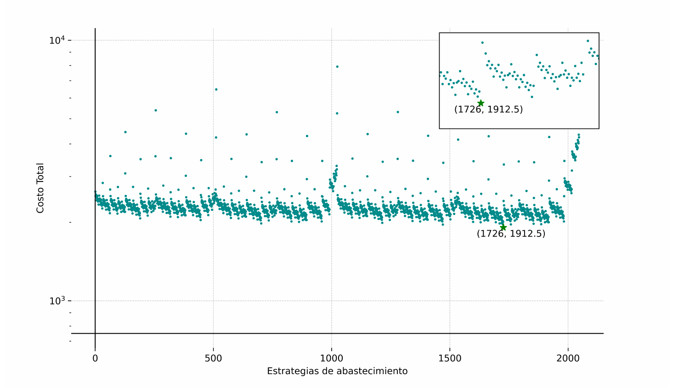
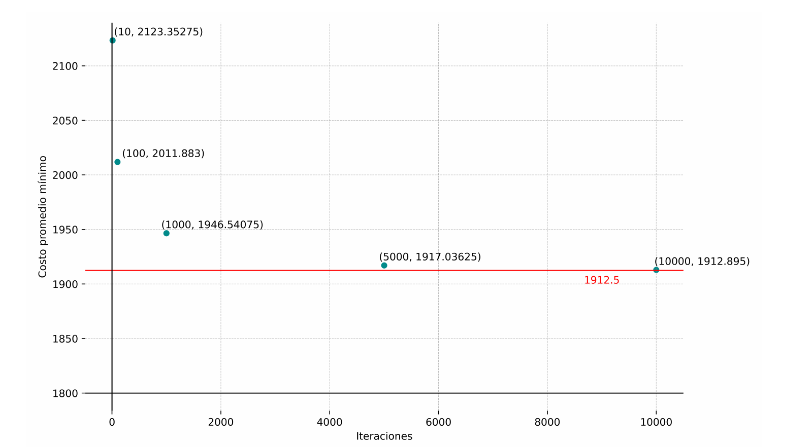

```{r setup, include=FALSE}
knitr::opts_chunk$set(echo = FALSE)
```

## Hipótesis central y recorrido

> **Los solvers no garantizan optimalidad; Un LLM puede reducir la fricción para formular, actualizar y explicar el modelo.** Sustituir uno por otro pierde rigor o pierde escala.

<div class="two-col">
<div class="col">

**Tres pasos en esta presentación**

1. **Cimientos**: Lo que has visto en cálculo infinitesimal (derivada).
2. **Motor**: GUROBI como árbitro de factibilidad y optimalidad MCMO.
3. **Interfaz**: ICARUS (Ivanov, IJPR 2026) y el caso de **agrupamiento de pedidos** de Mieras y Palma.

</div>
<div class="col">

<p class="center"></p>
<p class="tiny center">La complejidad no está solo en calcular, sino en traducir la operación a un modelo.</p>

</div>
</div>

## La base: análisis matemático de una variable

En primer año se optimiza una función **continua y suave**:

$$
f'(x^{*})=0 \quad \text{(condición necesaria)}, \qquad f''(x^{*})>0 \quad \text{(mínimo local)}.
$$

| Aporte | Limitación |
|---|---|
| Da condiciones exactas de optimalidad local. | Exige derivabilidad; falla en funciones escalonadas o con esquinas. |
| Permite interpretar sensibilidad mediante la derivada. | No incorpora restricciones, enteros ni decisiones secuenciales. |
| Es la base de Newton-Raphson y del EOQ. | En no convexo, el crítico puede ser solo **local**. |

**Traducción industrial**: Ej. Decidir *cuánto pedir* es continuo en el EOQ, pero decidir *cuándo pedir, con descuentos y deterioro* es discreto y no suave.

## Del vértice al óptimo: el simplex y sus límites

<div class="two-col">
<div class="col">

<p class="center"></p>
<p class="tiny center">Wikimedia Commons, <em>Simplex-method-3-dimensions</em> (CC BY-SA 3.0).</p>

</div>
<div class="col">

**Importante Enteder -> Qué hace**

$$
\max\; c^\top x \quad \text{s.a.}\quad Ax\le b,\; x\ge 0
$$

Camina de vértice en vértice del politopo mejorando el objetivo.

**Matiz importante**: el simplex optimiza **una función objetivo con muchas variables**. Si hay una sola variable, el factible es un intervalo y el óptimo está en un extremo: basta comparar cotas, no hay pivotaje.

**Límites**

- Lineal por construcción: no modela curvatura ni deterioro directo.
- Variables continuas: enteros exigen MILP.
- Peor caso exponencial (Klee–Minty); degeneración y ciclado.
- Descuentos por volumen crean saltos donde $f'$ no existe.

</div>
</div>

## Panorama evaluado: métodos clásicos y brecha de uso

| Método | Ideal para | Límite principal |
|---|---|---|
| Derivadas / Newton | Modelos suaves, continuos | Solo óptimos locales; sin restricciones duras |
| EOQ / balance de periodo | Demanda estable | Supuestos muy restrictivos |
| Wagner–Whitin | Demanda variable, programación dinámica | No deterioro ni descuentos por volumen |
| Silver–Meal | Heurística rápida | Falla con periodos de demanda cero |
| Simplex / MILP | Restricciones lineales y enteras | Requiere formulación experta |
| Búsqueda tabú | Espacios combinatorios no lineales | No garantiza el óptimo en cada corrida |

<div class="center small">
**Brecha persistente:** pregunta gerencial $\rightarrow$ formulación $\rightarrow$ datos $\rightarrow$ solver $\rightarrow$ explicación.
</div>

## GUROBI: qué es y cómo decide

<div class="two-col">
<div class="col">

<p class="center"></p>

</div>
<div class="col">

**Solver comercial de optimización matemática**: LP, QP, MIP, MIQP y MIQCP.

**Flujo interno simplificado**

1. *Presolve*: reduce y fortalece el modelo.
2. *Branch-and-bound / branch-and-cut*: explora un árbol con cotas.
3. *Cortes y heurísticas primales*: mejoran la cota y obtienen soluciones factibles.
4. Devuelve estado, objetivo, solución, holguras, precios sombra e **IIS** si es infactible.

**Fortaleza**: prueba de optimalidad. **Límite**: no entiende lenguaje natural ni decide qué problema resolver.

</div>
</div>

<p class="tiny">Logo: Wikimedia Commons, dominio público. Documentación: docs.gurobi.com.</p>

## El eslabón débil no es el solver, es su uso

| Escenario | Qué gana | Qué pierde |
|---|---|---|
| Excel Solver | Accesibilidad inmediata | Escala, diagnóstico y trazabilidad MUY limitados |
| GUROBI aislado | Rigor y velocidad | Dependencia de un experto que formule y explique |
| Bucle ICARUS + GUROBI | Lenguaje natural, datos vivos, explicación | Requiere validación de la especificación generada |

<div class="highlight small">
**Hipótesis empírica del equipo (Mendoza, Argentina):** el enfoque basado en Solver de Excel rinde entre **30 % y 40 % por debajo** del bucle ICARUS/GUROBI. Es una observación propia sobre 94 empresas PyME, no un benchmark publicado aún. 
</div>

<p class="tiny">Contraste: Simchi-Levi et al. (2026) reportan decisiones de días/semanas a minutos/horas, sin diseño experimental replicable.</p>

## Ivanov (IJPR, 2026): ICARUS y gemelos agénticos

<div class="two-col">
<div class="col">

**Ivanov, D. (2026).** *Agentic digital twins…*, **International Journal of Production Research**, 64(15), 6574–6590. DOI: 10.1080/00207543.2026.2630277.

**ICARUS** = seis dimensiones:

- **I**nteraction
- **C**reativity
- **A**daptation
- **R**easoning
- **U**biquity
- **S**ynchronization

**Tesis**: el gemelo digital agéntico (A-SCDT) envuelve al modelo: el agente formula escenarios y el solver los certifica.

**Límite**: trabajo conceptual, con validación empírica sistemática.

</div>
<div class="col">

<p class="center"></p>
<p class="tiny center">Wikimedia Commons, <em>Digitaler Steuerungs-Zwilling</em>.</p>

</div>
</div>

## División de responsabilidades en el bucle

<div class="center small">
Humano $\rightarrow$ agente traductor $\rightarrow$ datos del gemelo/ERP $\rightarrow$ modelo formal $\rightarrow$ **GUROBI** $\rightarrow$ agente explicador $\rightarrow$ humano
</div>

| Componente | Rol | No hace |
|---|---|---|
| LLM / agentes | Traducir, orquestar, explicar | Calcular el óptimo |
| Gurobi | Garantizar factibilidad y optimalidad | Interpretar lenguaje natural |
| Gemelo digital | Ser fuente de verdad actualizada | Decidir por sí mismo |

**Dos riesgos que exigen humano en el bucle**

- **Alucinación en la formulación**: óptimo del problema equivocado.
- **Falsa explicación**: narrativa plausible sobre por qué el solver eligió.

## GUROBI dentro del bucle agéntico

<p class="center"></p>

<div class="two-col">
<div class="col">

**Tres niveles de integración**

1. *Tool calling*: `build_model`, `solve_model`, `get_solution`, `compute_iis`, `sensitivity_analysis`.
2. *MCP de Gurobi*: **Modeler** (formula), **Explainer** (diagnostica), **Gurobot** (API).
3. *Capa determinista*: JSON validado $\rightarrow$ plantillas `gurobipy` $\rightarrow$ tests, cotas y auditoría.

</div>
<div class="col">

<pre>
{
  "objetivo": "min",
  "variables": ["x[i,j]"],
  "restricciones": ["demanda[i] &lt;= sum(x[,i])"]
}
</pre>

<p class="tiny">El agente propone la especificación; el código del solver se genera con plantillas validadas.</p>

</div>
</div>

<div class="highlight small">
**Regla de oro**: nunca dejar que el LLM escriba y ejecute `gurobipy` libre sin validación.
</div>

## Caso Mieras–Palma: agrupamiento de pedidos

<div class="two-col">
<div class="col">

<p class="center"></p>
<p class="tiny center">Margarita Miguelina Mieras · línea Di3.</p>

</div>
<div class="col">

En MRP, **agrupar pedidos** decide cuántos periodos consecutivos cubre cada reposición.

$$
N_{\text{estrategias}} = 2^{N-1}
$$

- $N=12 \rightarrow 2\,048$
- $N=24 \rightarrow 8\,388\,608$
- $N=30 \rightarrow 5\,368\,870\,912$ (reportado en el paper)

Lotes pequeños: menos inventario, más pedidos. Lotes grandes: descuentos, pero más deterioro y capital inmovilizado.

<p class="tiny">Fuente: Mieras et al., arXiv:2412.02714v1 (2024).</p>

</div>
</div>

## Formulación del modelo (I): estrategias y costos

<div class="two-col">
<div class="col">

**Variables**: $C_p$ pedido, $C_m$ mantenimiento, $C_a$ adquisición, $C_d$ deterioro, $\alpha_i$ requerimiento, $\mu$ vida máxima, $q_k$ umbral de descuento, $N_{p_j}$ pedidos de la estrategia $j$.

$A[j,i]$ = tamaño del lote que se inicia en $i$; $T[j,i]$ = periodos cubiertos; $j=1,\dots,2^{N-1}$.

$$
\mathrm{CT}_j=\mathrm{CP}_j+\mathrm{CM}_j+\mathrm{CA}_j+\mathrm{CD}_j \tag{1}
$$

$$
\mathrm{CP}_j=C_p\,N_{p_j} \tag{2}
$$

$$
\mathrm{CA}_j=C_a\sum_{i=1}^{N}\;\sum_{l=i}^{T[j,i]+i-1}\alpha_l \tag{4}
$$

$$
C_a(\alpha_l)=C_{a,k}\;\text{si}\;q_{k-1}&lt;\alpha_l\le q_k,\quad
C_{a,1}&gt;C_{a,2}&gt;\cdots&gt;C_{a,K} \tag{5}
$$

</div>
<div class="col">

<p class="center"></p>
<p class="tiny center">Explosión combinatoria del espacio de estrategias (Mieras et al.).</p>

</div>
</div>

## Formulación del modelo (II): objetivo completo

$$
\mathrm{CM}_j=C_m\sum_{i=1}^{N}\;\sum_{l=i}^{T[j,i]+i-1}\alpha_l\,(l-i) \tag{3}
$$

$$
\mathrm{CD}_j=C_d\sum_{i=1}^{N}\;\sum_{l=i}^{T[j,i]+i-1}\alpha_l\,\big((l-i)-\mu\big) \tag{6}
$$

$$
\begin{aligned}
\mathrm{CT}_j=\; & C_p N_{p_j}
+ C_m\sum_{i=1}^{N}\sum_{l=i}^{T[j,i]+i-1}\alpha_l(l-i)
+ C_a\sum_{i=1}^{N}\sum_{l=i}^{T[j,i]+i-1}\alpha_l \\
& + C_d\sum_{i=1}^{N}\sum_{l=i}^{T[j,i]+i-1}\alpha_l\big((l-i)-\mu\big),
\qquad i\le l \tag{7}
\end{aligned}
$$

$$
j^{*}=\arg\min_{1\le j\le 2^{N-1}}\mathrm{CT}_j
$$

<p class="tiny">Con $C_a=C_a(\alpha_l)$ según (5). Convención: suma vacía = 0 cuando $i&gt;l$; en la implementación solo se penaliza el exceso sobre $\mu$. Para $N=12$: $j^{*}=1726$, $\mathrm{CT}=\$1912{,}5$, pedidos de 40, 75, 95 y 75 unidades en $i=1,4,6,11$.</p>

## Evidencia: enumeración exacta frente a búsqueda tabú

<div class="two-col">
<div class="col">

<p class="center"></p>
<p class="tiny center">Las 2 048 estrategias y su costo total.</p>

</div>
<div class="col">

<p class="center"></p>
<p class="tiny center">La tabú se acerca al mínimo al aumentar iteraciones.</p>

</div>
</div>

- **Modelo analítico**: evalúa todo el espacio y certifica el mínimo global con 2 048 cálculos.
- **Búsqueda tabú**: converge, pero requiere millones de evaluaciones; con $k=10\,000$ acierta en la mayoría de los experimentos, no en todos.
- **Tensión**: el modelo gana precisión y eficiencia hasta que $N$ crece; allí entraría la propuesta de acotar zonas de búsqueda con apoyo de IA.

## Conclusiones: una arquitectura híbrida y verificable

1. El **cálculo diferencial y el simplex** son indispensables, pero insuficientes para decisiones discretas y funciones escalonadas.
2. **GUROBI** aporta garantías: factibilidad, cotas, optimalidad y diagnóstico de infactibilidad.
3. **ICARUS** no reemplaza al solver: lo hace usable, sincronizado y comprensible; exige mantener al humano en el bucle.
4. **Mieras y Palma** muestran que un modelo analítico exacto puede superar a una metaheurística en costo computacional; el reto es escalar.

<div class="highlight center">
**El agente propone · el solver dispone · el humano valida.**
</div>

<p class="tiny center">Referencias: Mieras et al. (2024), arXiv:2412.02714v1 · Ivanov (2026), IJPR 64(15) · GUROBI Intelligence/MCP docs · Simchi-Levi et al. (2026), Springer.</p>
